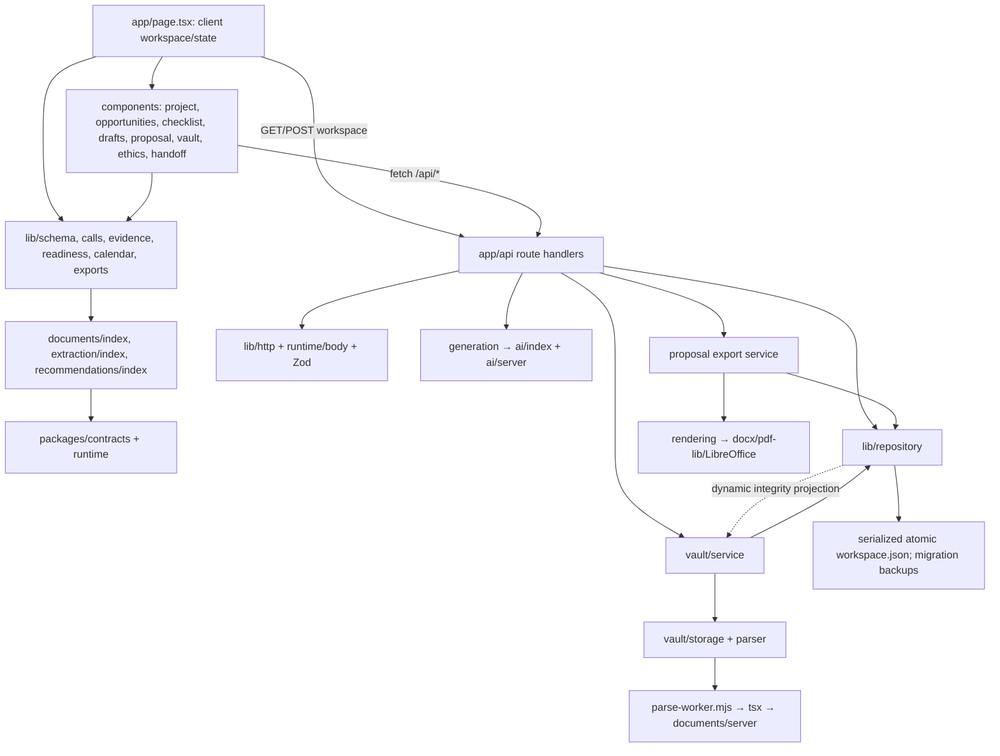

# Infrastructure and frontend/API review — main b4485b6

Reviewed October 25, 2026. Source: `b4485b6730dac3585a33ebc1e1bfe739af20cc21`; review branch: `review/infrastructure-b4485b6`. Lead is sole report/evidence writer. Two independent agents audited API/dependency wiring and document/evidence integrity read-only. No application source, dependencies, shared tests, central documentation or workflows were changed.

## Verdict and demo impact

The implemented frontend, routes, domain commands and local persistence form a connected application. The checked main supports manual/no-key preparation, 14 NSF proposal editors, reviewed reuse, immutable document versions and handoffs. The judge-visible mechanism is a reviewed requirement tied to retained original bytes and a frozen handoff, including explicit decisions after replacement.

**One confirmed P1 prevents an unqualified infrastructure approval:** draft readiness can accept missing/corrupt original evidence, and selected evidence without a quotation misses file replacement staleness. Generation applies stricter checks. Repair this common evidence boundary through the assigned application writer before representing all current readiness checks as integrity-safe. Other findings are bounded error recovery and backup-coverage issues; no missing implemented route/import was found.

The existing main review is [http://127.0.0.1:3000](http://127.0.0.1:3000). This review personally fetched its page and health: both HTTP 200; revision matched reviewed main; build `LjphVZDJouChizrnx1j9P`. Normal workspace data/server were not edited, uploaded into, reset or restarted. This is local review evidence, not public deployment or sponsor acceptance.

## Findings and repair handoff

### F1 — P1: draft readiness omits parts of its file evidence dependencies

Locations: `lib/readiness.ts:306` (selected source version/hash), `lib/readiness.ts:329` (citation checks), `lib/evidence.ts:61` (citation staleness), `lib/vault/domain.ts:78` (file head only). Compare the stricter gate at `lib/generation.ts:47`. `lib/repository.ts:562` allows Ready for review when this readiness result has no blockers.

Reproduction personally executed with actual pure domain functions, exit 0:

1. Construct synthetic document/version/parse/source records with an exact reviewed origin. Accept the complete graph using `StateSchema`, `validateStateIntegrity` and `validateVaultState`.
2. Use normal commands to create an application, confirm synthetic checklist prerequisites and save three manual sections. All select the reviewed source; summary also quotes it. The initial readiness result has zero blockers.
3. Change the original version's runtime integrity to `corrupt`, then independently to `missing`. No attachment/ethics reference points to this document.
4. Both cases still return zero blockers and `applyCommand(setStage("Ready for review"))` succeeds. `generationContext` for the same source rejects `EVIDENCE_REVIEW`.
5. Add document v2 while retaining reviewed v1 and unchanged promoted-source version/hash. `sourceFileStale` is true. Quoted summary gets `citations-stale-summary`; selected-only significance/approach get no source-staleness blocker.

Impact: an application can appear ready with unverifiable file-backed draft support. Attachment and ethics integrity checks work for their separately linked files; they do not cover all draft evidence. Retained excerpts still resolve as text, which is insufficient to establish current original integrity. Manual evidence with no file origin is unaffected by this finding.

Proposed bounded repair: use consistent current-origin availability, exclusion and reviewed-head checks for selected draft support and citations; emit an unwaivable vault-integrity finding for unavailable originals. Preserve intentional manual-edit semantics and retained historical versions. Add focused corrupt/missing/replacement tests, including a zero-other-blocker Ready attempt. The report does not implement this repair. Parent was notified immediately with the evidence and Task 03's exclusive shared-file lease respected.

Repro source and result: [pure-readiness-repro.ts.txt](evidence-b4485b6/pure-readiness-repro.ts.txt), [pure-readiness-result.json](evidence-b4485b6/pure-readiness-result.json). Copy the source to `.test-data/infra-review-b4485b6/pure-readiness.ts` at repository root; with the locked dependencies installed, run `node --import tsx .test-data/infra-review-b4485b6/pure-readiness.ts`. It makes no network/provider/parser calls and writes only its result in that private directory. The pure probe models the runtime projection directly; a physical-file HTTP probe is separately recorded below.

### F2 — P2: malformed upload metadata is reported as an internal server error

`app/api/documents/route.ts:17` directly applies `JSON.parse` to decoded header bytes. `X-Upload-Metadata: ew` is legal base64url but decodes to incomplete JSON `{`. With a valid local origin, octet-stream content type and body `x`, parsing throws before storage access. `packages/runtime/src/index.ts:36` maps the uncaught syntax error to `INTERNAL_ERROR`/500 instead of an input 400.

Personally reproduced both by direct invocation of the actual route with a `Request` (exit 0, before storage access) and by HTTP against the isolated copied production build. [Metadata evidence](evidence-b4485b6/metadata-result.json) and [direct repro](evidence-b4485b6/metadata-repro.ts.txt) retain the exact input/result. Proposed repair: catch invalid JSON/UTF-8 metadata decoding and return a bounded input error; retain the strict metadata schema and existing body limits. One focused malformed-header regression is sufficient. No normal data mutation is needed to reproduce.

### F3 — P2: full NSF editor/export UI hides structured API recovery messages

`components/proposal-panel.tsx:605`, `:1889`, `:1926`, `:1990` construct `new Error(data.error ?? ...)`; API errors contain an object `{code,message,...}`. JavaScript converts that object to `[object Object]`. Starter drafting correctly reads `result.error?.message` at `components/drafts.tsx:108`.

Repro from source: adopt the NSF template and request live generation with consent while `RUN_LIVE_AI` is absent. The API's actionable `LIVE_DISABLED`/manual-workflow message becomes opaque. Export start, polling and cancellation failures share the mismatch, including revision-conflict guidance. Buffers are preserved, but the user cannot see the intended recovery instruction. Proposed repair: consistently extract the structured message with a safe string fallback. UI browser reproduction was not personally executed in this review; code paths and API error shape were inspected.

### F4 — P2 operational limitation: repository backup is incomplete for proposal downloads

`lib/repository.ts:723` copies workspace metadata and verified vault originals/extractions, retaining `proposalExports` metadata. It omits the `proposal-exports/` directory used by `lib/proposals/export-service.ts:412`. Restoring that helper's result into a new data root leaves saved proposal artifact records without their bytes; the download path reports unavailable/409 rather than recovering them. The inspected restore test exercises vault originals, not completed proposal exports.

This is a static finding; a completed-export restore was not rerun. Do not interpret the vault restore test or release's “blobs/artifacts” wording as proof of a complete application backup. Preserve the entire data directory for operational backup until the helper includes proposal artifacts or is explicitly documented as vault-only. Pre-migration byte backups are a separate, correctly implemented safeguard.

## Actual dependency graph

This is the actual import/runtime structure, not a proposed distributed architecture. Repository mutation projection dynamically imports services that consume the repository: there is an existing cycle. No import-time failure was demonstrated. Browser-safe schemas/domain helpers do not import those server paths.

The read-only agent's source closure scan from `app/page.tsx` found 29 source files, no missing relative imports and no `node:` builtins/server credential path in that closure. The compiler/production CI adds stronger integration evidence; regex scanning alone is not bundle proof. Node file I/O, workers, child processes and provider credentials stay in server-only paths by current import direction; there is no universal `server-only` sentinel enforcement.

`tsconfig.json` uses strict TypeScript, bundler module resolution and three real aliases: `@kit/runtime`, `@kit/contracts`, `@kit/body`. `next.config.mjs` aliases `.js` resolution to `.ts`/`.tsx`/`.js`; production/dev explicitly use webpack. Root `package.json` and lock v3 agree. Current exact root pins include Next 16.4.3, React 19.3.1, Zod 4.6.7, TypeScript 6.0.3, tsx 4.23.15, PDF.js 6.4.299 and Mammoth 1.13.0. Imported kit module metadata records older pins; root package/lock controls this application installation. No dependency upgrade is proposed by this review.

## Registered routes, requests and consumers

Common success responses are no-store. Local application routes reject non-loopback Host and cross-site Fetch Metadata; writes require matching Origin. This is a single-user loopback boundary, not hosted authentication. Mutation/generation/upload/export/retry envelopes are strict; many nested command/value objects use Zod's default stripping of unknown keys. Recognized fields and relational references are validated; do not claim every nested object rejects unknown keys.

| Method / path | Actual consumer / request | Validation and return |
| --- | --- | --- |
| GET `/api/workspace` | Page initial load, refresh, conflict comparison | Local request; migration/recovery, graph validation and renderer/file projection; schema-3 state, 200 |
| POST `/api/workspace` | Page `mutate`; editor `{expectedRevision,command}` | Same-origin JSON, 120,000 bytes, strict envelope, discriminated command and graph/revision validation; `{state,selectedId?}`, 200; 409 preserves buffers |
| POST `/api/generate` | Starter and full proposal editors; app/section/source IDs, revision, fixture/live mode, consent | JSON/120 KB; strict input, project/source checks, one active request/six attempts per minute, 22-second route cancellation; validated preview/token/mode/input revision, 200; no draft save |
| POST `/api/documents` | `DocumentUpload`; raw File with base64url `X-Upload-Metadata` | Exact octet-stream; 4,096 encoded metadata bytes; strict schema; 10,000,000 raw bytes/15 seconds; admission/quota/replay/revision checks; `{state,documentId,versionId}`, 201; F2 syntax exception |
| GET `/api/documents/{id}/versions/{versionId}` | Registered metadata API; UI normally uses workspace records | Document/version membership; `{document,version,attempts}`, 200 |
| GET `…/text?attemptId=` | Vault `VersionView.readText` | Original integrity, version/attempt membership, extraction hash/length; `{text,segments,artifactSha256}`, 200 |
| POST `…/parse` | Vault retry button; revision/retry key | Same-origin strict JSON/4 KB; version membership and bounded queue; append-only attempt, 202 |
| GET `…/download` | Vault, attachment and ethics links | Scoped version; original length/SHA-256; attachment bytes, 200, nosniff |
| POST `/api/applications/{id}/handoffs` | Handoff panel; revision/phase/retry key | Same-origin strict JSON/4 KB; frozen selections/reviews/answers/warnings; `{state,handoffId}`, 201 |
| GET `…/handoffs/{snapshotId}` | Registered manifest API; UI also consumes workspace snapshots | Application/snapshot membership; snapshot, current-input comparison and download targets, 200 |
| GET `…/handoffs/{snapshotId}/{versionId}/download?requirementId=` | Saved handoff links | Application/snapshot/requirement/version/project membership and pinned byte hash/length; original attachment, 200 |
| GET `/api/proposal-templates` | Registered API; proposal UI imports same bundled manifests directly | Local/export-origin checks; bundled template metadata, 200; no remote refresh |
| POST `/api/proposal-exports` | `PacketExports`; snapshot/revision/optional retry | Same-origin strict JSON/120 KB; snapshot digest/revision/queue/idempotency; `{state,exportId}`, 202 |
| GET `/api/proposal-exports/{id}` | Export polling | Safe ID and snapshot checks; job/current-input/current-renderer flags, 200 |
| DELETE `/api/proposal-exports/{id}` | Cancel; expected revision | Same-origin strict JSON/120 KB and revision; `{state,exportId}`, 200 |
| GET `/api/proposal-exports/{id}/{artifactId}` | Packet/component links | Allowlisted saved artifact; real path/file/length/hash checks; attachment bytes, 200, nosniff and sandbox CSP |
| GET `/api/health`, `/api/ready` | Review launcher/diagnostics | Health: instance/build/revision; ready: repository readable/manual mode. Diagnostic handlers omit `assertLocalRequest`; configured servers bind loopback. Readiness does not verify AI or sponsor rules. |

Expected boundary failures include 400 invalid input, 403 local/origin/scope rejection, 404 absent record, 409 stale revision/idempotency conflict or export artifact unavailability, 413 raw byte bound, 415 wrong type, 422 admission/semantic failure and 503 unreadable storage. F2 is the malformed-metadata exception. Missing/corrupt original downloads fail rather than serving altered bytes.

Revision/dirty recovery: `applyCommand` checks expected revision before mutation (`lib/repository.ts:64`). Page mutation refreshes saved state after 409 (`app/page.tsx:129`), retaining editor buffers. Automatic refresh replaces page state only when no registered dirty editor exists (`:81`); the comparison/rebase UI (`:350`) lets the researcher resolve it. Editors have stable identities and local buffers, with navigation/unload guards. Upload/handoff inputs survive errors. CI browser journeys cover these flows; this review did not rerun Chromium.

## Document, provenance and persistence checks

- App admission permits TXT, MD, PDF and DOCX. Kit CSV/OCR support is not an app upload feature. UTF-8 decoding is fatal for malformed text; NUL/disguised binary is rejected. PDF admission requires markers; parsing may still fail while originals remain downloadable. DOCX checks local/central headers, CRC, bounded actual expansion, internal relationships and active payload exclusions. This intentionally rejects some otherwise complex packages.
- Immutable bytes publish through staged sync and exclusive hard-link creation; generated IDs define paths. Reads verify length/SHA-256; storage rejects unsafe links/paths. Limits include 10 MB/file, 250 MB physical blob/staging quota, 50 MB extraction artifacts, 100 documents/project and 20 versions/document.
- One parsing worker plus four waiting slots; 20-second termination, 384 MB old/32 MB young heap bounds, 100 PDF pages, 200,000 UTF-16 units and 10,000 segments/artifact. DOCX admission inflation/CRC occurs synchronously before worker parsing; bounds do not make it an OS sandbox.
- The production parser needs the source tree, `lib/vault/parse-worker.mjs`, `modules/documents/src/server.ts`, shared packages and a full install containing `tsx`. Copying only a compiled server or omitting development dependencies is insufficient for this implementation. Current documented full `npm ci` supports the runtime. OCR is absent from the app worker.
- Promotion checks the exact extraction slice and pins original version, parse attempt, artifact SHA-256, UTF-16 start/end, reviewer and reviewed head. BOM/CRLF normalization and emoji offsets are covered in inspected tests. Manual edits retain historical origin with `manualEdit`; document content stays data and rendered text. Generation uses a fixed untrusted-input instruction with no document-triggered tools/fetches.
- Selection is independent of parsing and human format/relevance review. Replacement keeps selected v1 and adds a review need rather than relinking. Attachment/ethics integrity checks and original/handoff downloads are stricter than the draft-evidence gap F1. Archive retains referenced bytes. No upload/download auto-submits or certifies approval.
- Repository operations serialize through one process-local promise queue; validate schema/reference graphs, write an exclusive temporary file, sync and atomically rename. Failed queues do not poison later operations. There is no multi-process lock.
- v1/v2 migration validates the previous schema, makes an exclusive byte-identical backup before atomic replacement, preserves historical proposal payloads and adds schema-3 collections. Unknown/corrupt state and missing metadata beside retained vault/backups fail closed. Initial demo data is created only for genuinely absent storage. Reset protection retains researcher-linked parents. Inspected tests plus CI cover migration/byte backup, corrupt state, graph rejection and vault restore; the normal workspace was never used as an acceptance fixture.
- Fixture project/call/generation labels remain explicit. Fixture drafting rejects researcher evidence; live mode requires server configuration and per-request consent, without silent fixture fallback. Manual operation remains available. Task 04's separately verified plan access is not merged generation behavior here.
- All 14 NSF sections, structured blocks, scoped approved reuse, immutable packet inputs, source appendices and external portal tasks remain in main. Missing rendering prerequisites retain DOCX with Unknown page counts. Real LibreOffice/fonts were not repeated here; previous release evidence is attributed separately, not inferred from no-renderer browser tests. Arbitrary sponsor packages, hosted users and sponsor submission are not implemented claims.

## Verification ledger

All personally executed source probes use reviewed source `b4485b6`; this documentation commit changes no application behavior.

| Evidence / command | Result and ownership | Isolation / limit |
| --- | --- | --- |
| `git rev-parse HEAD`, status and branch inspection | Clean initial worktree at exact requested SHA; review branch created | Own worktree only |
| PR #7 diagnostics and validation job log read | Independently retrieved: exact head `7a830d310417c410558c6f532e256ea8d7e651f8`, required validation success | CI-executed, not locally rerun; [job](https://github.com/vzhu08/grantpath/actions/runs/40170419279/job/121099973496) |
| Compare main/checked-PR source trees | Both tree `0c99d84b32c6f87f4dd4d7438f4e358678ab7fdc`; `git diff --exit-code` exit 0 | Makes exact-tree CI evidence applicable to reviewed main |
| CI log: locked install, audit, types/tests/build | Job success; 152 tests/14 suites; production compiled | Ordinary provider transports mocked; no claim of new paid calls |
| CI log: `npm run test:browser`, `node scripts/vault-browser.mjs` | Both acceptance steps passed; baseline/proposal and immutable vault journeys/restart | CI-owned synthetic data/browser; this review did not personally rerun |
| `Invoke-WebRequest` on normal page and health | Exit 0 after sandbox socket retry; both 200; expected revision/build | GET only; no normal workspace mutation |
| Node/npm versions | v24.12.0 / 11.6.2 | No install in this checkout |
| Agent read-only import/lock scans | Exit 0; 29 client-closure files; no missing relative import or Node builtin; root pins match lock | Static regex scan; compiler evidence above is stronger |
| `node --import tsx .test-data/infra-review-b4485b6/pure-readiness.ts` | Exit 0; baseline 0 blockers; corrupt/missing both 0 blockers/Ready accepted; generation rejected; replacement selected-only gap confirmed | Actual pure source; synthetic valid graph; no parser/server/provider/disk repo. `TSX_DISABLE_CACHE=1`, TEMP/TMP own private directory |
| `node --import tsx .test-data/infra-review-b4485b6/probe-metadata.ts` | Exit 0; actual malformed Request returns 500/INTERNAL_ERROR rather than input 400 | Direct actual route, invalid input exits before repository access |
| Existing build copied with `robocopy … /E /XD …/cache` | Robocopy 1 (successful copy), wrapper exit 0; copied BUILD_ID matches | Own `.next`; no credentials/env/data copied; dependencies borrowed for read-only import through temporary junction |
| `PORT=3120 GRANTPATH_DATA_DIR=.test-data/infra-review-b4485b6/data APP_REVISION=b4485b6… npm run review` | Exit 0, expected health revision/build; performed again for actual restart | Existing copied build; no rebuild/install; normal 3000/data untouched |
| `node --import tsx .test-data/infra-review-b4485b6/probe.ts` | Exit 0; 113 request-status assertions including polling, plus payload/hash/domain assertions | Sequential tiny synthetic files, one bounded parser; no browser/provider/renderer |
| `node --import tsx .test-data/infra-review-b4485b6/selection.ts` | Exit 0; explicit selection/review, later replacement, pinned v1 handoff SHA, foreign requirement 404 | Same private workspace/server; one additional tiny parse |
| Identity-checked owned process stop → `npm run review` → `node --import tsx …/restart.ts` → owned stop | Exit 0; complete state deep-equal after real process restart; pinned original SHA unchanged, download 200 | Both stopped processes matched own private server record/health instance; no unrelated process stopped |

Dynamic work began only after the parent's explicit window following Task 03's completed production check/build. The slot was returned immediately after the owned server stopped. The final private server is stopped; port 3120 is not a persistent user review URL.

Personally checked through HTTP: TXT/Markdown/PDF/DOCX all parsed; BOM/CRLF/emoji extraction and reviewed exact-source promotion; invalid UTF-8 422, unsupported type/MIME 415, 120,001-byte JSON and 10,000,001-byte upload 413, malformed JSON 400, cross-origin writes/cross-site reads 403, mismatched document 404, and stale draft save 409 without changing saved text. A structurally admitted malformed PDF became a failed parse while its original remained downloadable. A corrupted original was projected as corrupt and download returned 503; readiness on that actual projected state added no issue while generation context rejected it, corroborating F1's stronger pure zero-blocker proof.

The selection/handoff portion accepted an explicitly reviewed v1, then a third version caused a visible pinned-review issue. The frozen handoff still selected v1; its original download SHA-256 was `22e3bcd98bf708e0baaac39e20f8140c47d6d2ab372a1fc62db8cc5a88273a67` before and after restart. Changing the handoff requirement to a foreign ID returned 404. These checks corroborate the intended immutable-byte mechanism even while F1 remains open.

Sanitized [dynamic results](evidence-b4485b6/dynamic-result.json) retain statuses and hashes; repeated workspace polling is omitted from its request list. Reproduction source is retained as text: [HTTP flow](evidence-b4485b6/http-flow.ts.txt), [selection flow](evidence-b4485b6/selection-flow.ts.txt), [restart check](evidence-b4485b6/restart-check.ts.txt). Copy them to the corresponding private `.test-data/infra-review-b4485b6/*.ts` names to run. These scripts intentionally assert the observed b4485b6 defects; they are evidence probes, not a passing correctness gate for later repaired code.

Full local `npm ci`, check/build, module suites/demos, browser suites and renderer tests were intentionally not repeated alongside the active writer's heavy slot. Their existing CI/release evidence is attributed above; unavailable personal checks cannot establish additional behavior. This review exercised the browser's actual API contract directly; frontend interaction, dirty buffers, all 14 editors and mobile rendering rely on source audit plus the inspected CI browser journeys.

## Prerequisite matrix for later research

This review does not start research or design tasks 11–13. Documentation/spec checkpoints and feature-only branches are not merged application interfaces. Task 10 (teams) is explicitly skipped and is not a local-demo dependency.

| Future research | Real prerequisites present on b4485b6 | Required facts/contracts not merged or unverified | Gate assessment |
| --- | --- | --- | --- |
| 11 GrantWeave | `ProfileSchema`, versioned `Opportunity`/call criteria/deadlines, confirmed requirement/citation provenance; document originals and proposal revisions/snapshots | Task 05 actual approved-award/amendment/provenance interfaces; Task 06 actual cost/budget/ledger/version contracts; confirmed work-package/overlap/effort constraint inputs and human grants-domain decisions. A single `fundingNeed` or call maximum is not an allocation model. | Hold research until necessary 05/06 implementations are checked/merged and F1 integrity repair is available. Live feed 09 and teams 10 are not mandatory. |
| 12 AimFit | Versioned project profile, source evidence, structured proposal revisions, approved reuse and immutable snapshots | Task 06 reliable cost/budget arithmetic and real exported version contracts; no merged explicit study-assumption/design model. Human design-family and statistical reference/validation choices remain necessary. | Hold for actual cost/budget prerequisite and integrity repair; anchor later research to actual main interfaces. No dependency on live discovery or institutional integration. |
| 13 Bootstrap | Task 02 retained file versions/exact reviewed origins, text evidence and proposal snapshots | Task 03 actual concern→action→evidence→revision/resubmission gap interfaces; Task 04 actual reviewed-rubric findings/gap contracts; Task 06 resource/cost inputs. Human-approved scientific candidates and valid gap-to-evidence interpretation remain gates. | Hold until necessary 03/04/06 implementations are checked/merged and F1 is repaired. GrantWeave/AimFit scenarios and live feeds are optional if bounded scope does not need them. |

The later tasks may define their own bounded new models after these predecessor facts settle; the table does not require every roadmap feature or a pre-existing solver before research. Task 05/06 logical specs can guide planning but do not prove runtime contracts, migrations or exports. Parent owns gate resolution, shared-source fixes and checked incremental main integration.

## Handoff and residual risk

Preserve this report as evidence for the specified revision. Any repair on Task 03 or later branches must pass its own regression/integration gates and be merged before main is described as repaired. A newer main requires a focused recheck of affected boundaries, not retroactive rewriting of this review's test results.

Remaining deliberate limits: one trusted local OS user/process, full source/runtime installation, bounded worker threads without OS containment, no hosted authorization/malware certification, no native OCR, no real-provider or sponsor-portal tests in this review, approximate PDF/DOCX extraction layout and human responsibility for scientific/ethics/sponsor decisions. These are proportional to the October 26 hackathon demo, whose exact cutoff was not supplied. Optional infrastructure expansion is deferred in favor of repairing the concrete integrity path and rehearsing the known-good demo.
