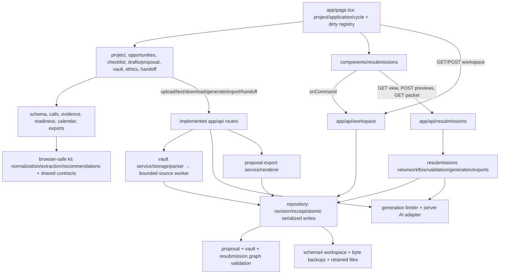

# Pre-UI functional and visual acceptance

**Preparation checkpoint — no final launch clearance.** Inspected source baseline: checked main `2da6a3104663d602424256217b19f2eba58c6996`, workspace schema 4, October 25, 2026. This document plans the independent gate requested by the human: “make sure previous tasks look good before implementing ui stuff.” It does not certify the unfinished combined application or start the redesign.

Lead is sole writer of this file and `pre-ui-evidence/**`; two agents independently reviewed workflow/usability coverage and API/data/reference coverage read-only. Current primary AGENTS, project brief, orchestration, ownership, task board and UI dispatch prompt were read. Earlier infrastructure review findings F1–F3 were closed on main 22404b6 and retained in this baseline; the [review and exact closure evidence](INFRASTRUCTURE_REVIEW_b4485b6.md) remain historical evidence for their named revisions.

## Gate and ownership

Task 05 currently owns shared application files and the heavy verification slot. The integration priority is **05 → 06 → 08**, with 04/07/09 later under explicit leases. Only source/document reading and this matrix are authorized now. No install, test suite, build, browser, renderer, dev/review server, provider call or normal-data mutation was performed for this checkpoint.

**Launch status: HOLD.** The final GO/NO-GO must wait for all selected 02–09 implementations to be checked and merged, the parent's exact final main SHA, and an explicit heavy review slot. Main 2da6a31 contains the implemented 02/03 workflows; 04/05/06/07/08/09 are provisional acceptance requirements until their accepted releases and actual merged interfaces are inspected. Their absence on this baseline is not a broken registered route.

Current primary records report main review `http://127.0.0.1:3000`, build `1B3ptr2eD4MVn0AxP33S7`, schema 4. Those are **parent-reported checkpoint values**, not a new personally executed health/visual check. Final acceptance will personally compare the then-current exact revision/build/health. Ordinary automated acceptance never uses port 3000 or its workspace records as fixtures.

The whole-product redesign remains queued until this combined gate and the implementation break. Cosmetic palette/type/theme work belongs to that redesign. The newer human override already authorizes separate research 11–13 and real-data feasibility; this review neither launches duplicates nor reimposes the older research-start restriction. No future 11–13 solver, NIH expansion or hosted/team capability is required to pass this gate.

## Evidence vocabulary

| Status | Meaning |
| --- | --- |
| M / pending final | Interface and named checks exist in merged 2da6a31. Inspected source/release evidence is available; combined final-revision execution is still pending. |
| P / provisional | Required behavior comes from the accepted task specification. Reconcile actual names, routes, types, receipts, migrations and tests after the feature's checked merge. No invented runtime interface or pass claim. |
| Executed | Reserved for a recorded command, exit, exact source/build, isolated data and retained evidence after the final slot. No feature row currently has this status. |

Source/test anchors below describe inspected coverage. A passing unit suite or old release does not establish the final rendered cross-feature journey.

## Feature acceptance matrix

| ID / status | Required user journey and cross-feature inputs | Concrete proof and regression checks | Source / existing coverage to reuse later |
| --- | --- | --- | --- |
| A02 / M, pending final | Upload synthetic TXT/MD/PDF/DOCX; inspect bounded extraction; promote an exact Unicode excerpt to research evidence; cite it in a saved draft. Separately select/review a CV original against a confirmed attachment rule; replace it and freeze a handoff. | Correct BOM/CRLF/UTF-16 offsets, repeated quote occurrence and reviewed file origin; retained v1 bytes/hash; replacement creates v2 without relinking selection; independent parse/relevance/format review; missing/corrupt/excluded original blocks current draft and attachment readiness, including selected-only evidence. Malformed/partial/no-text files retain originals with honest status. Handoff answers use each mapped requirement's label/limit; downloads remain scoped/hash-verified through restart. Future-phase ethics cannot become application-phase certification. | `lib/vault/{admission,parser,storage,service,domain,schema}.ts`; `components/documents/**`, ethics/handoff panels; `tests/vault/{workflow,storage,parser,readiness-evidence}.test.ts`; `tests/documents/{routes,metadata}.test.ts`; `node scripts/vault-browser.mjs`; [02 release](../implementation/02_DOCUMENT_VAULT_RELEASE.md). |
| A03 / M, pending final | Attest a partial submitted baseline, create an independent target cycle, quote separate reviewer feedback, record two concerns/actions, link actual evidence and target revisions, write a response and make human decisions. Resolve a supported clarification while an unfinished experiment remains open. | Coverage/exclusions/attestation remain explicit; original and target IDs/cycles differ; target inherits no Ready/Submitted/waiver assertion. Reviewer text cannot become scientific evidence. A changed linked source/target reopens only dependent rows; administrative owner/due edits preserve decisions. Missing/new-data/negative/inconclusive evidence remains correctly classified. Original/target comparison, ordered response opening/closing and old Markdown/JSON packet digest/bytes survive source edits and a real process restart. Lost-response receipts recover before stale revision rejection. | `lib/resubmissions/{schema,workflow,validation,view,matrix,comparison,snapshots,generation,exports}.ts`; `components/resubmissions/**`; `tests/resubmissions/{domain,repository,generation,vault-links,comparison,demo}.test.ts`; `node --import tsx scripts/resubmissions-acceptance.ts` and packet-only mode; [03 release](../implementation/03_RESUBMISSION_RESPONSE_MATRIX_RELEASE.md). |
| A04 / P | Freeze actual proposal/call/evidence inputs for advisory review; inspect reasons/passages, accept/dismiss findings and compare a corrected run. Exercise manual/no-key, clearly labeled fixture and unavailable/insufficient semantic states. | Planted contradiction versus compatible-control case; unsupported versus proposed result; missing section and malicious source text; exact retained anchors, nullable unassessed scores, useful explained 1–5 advisory scores only when supported. No scores/accepted findings from failed/partial streams; no automatic paid/API-key fallback. Decisions/tasks/reruns retain old run inputs and do not silently rewrite 03 actions or drafts. Final ordinary tests use mocked transport; inspect accepted feature live evidence separately without repeating provider/account calls. | [04 spec](../implementation/04_EVIDENCE_LINKED_RUBRIC_REVIEW_IMPLEMENTATION.md), §§5–9 and A01–A18. No merged `modules/review`/review-run consumer is asserted here. Bind to actual checked release tests/routes/auth contract after merge. |
| A05 / P | Confirm source-supported award terms from the correct actual submission; preserve proposed context; select a reviewed amendment; record real progress/delay/inconclusive outcome and freeze an annual narrative worksheet. | Submission-cycle provenance is explicit: a target's `originAttemptId` is not proof that target was submitted. Requested/approved/obligated/current-action/anticipated amounts stay distinct; unknown differs from zero. Stale amendment base/head fails without lost buffer or duplicate award. Planned work never becomes performed work; period/as-of/evidence-through and reviewed absence stay explicit. Prior worksheet and sources remain identical after amendment/evidence correction/restart; preparation status is not sponsor acceptance/certification. | [05 spec](../implementation/05_AWARD_OBLIGATIONS_PROGRESS_REPORTS_IMPLEMENTATION.md), §§5–7 and 05-T01–T20. Current predecessor anchors: `ApplicationSchema` cycle/origin fields, retained proposal/resubmission snapshots and exact source/file origins. Reconcile actual award-finance adapter after merge. |
| A06 / P | Select actual checked 05 award context; preview fixed CSV before explicit confirmation; repeat an import; settle a commitment, record refund and dependency-safe correction; freeze local ledger snapshots. | Independently hand-check 0.10 + 0.20 = 30 cents, all published fixture totals and negative balances. No paid/commitment/forecast double count; unknown allocation is not zero. Same semantic key/file with reordered rows creates no new event; changed payload under a used key conflicts; rejected rows remain visible and no partial commit. Partial/over settlement, backdated prefix violations, refund capacity, cross-period reductions and atomic correction graphs hold. Preserve immutable snapshots/CSV/JSON bytes, `text:` display-safety semantics and raw JSON. | [06 spec](../implementation/06_BUDGET_LEDGER_IMPLEMENTATION.md), §7 hand table and 06-T01–T22. Root arithmetic is not `Profile.fundingNeed`; no finance DTO/endpoint or current money implementation is invented. Bind actual tests/receipt/period/head contracts from merged 05/06 releases. |
| A08 / P | Map the selected actual 06 snapshot into a confirmed period/cutoff/basis internal report, inspect every contributing event, compare a separately specified synthetic statement, review and download saved bytes. | Principal witness: gross 400.00 − reductions 50.00 = net 350.00; categories 250.00/100.00; A=1,000.00 gives R=650.00; separately applicable A=1,200.00 gives R=850.00 while the old report remains 650.00. Commitment settlement is not counted twice; forecast 80.00 stays separate. Opening + period = closing, including negative period/refund cases; no missing/unassigned transaction disappears. Reconciliation differences/unknowns and human product-owner review remain visible; no institutional/sponsor certification. Source correction/amendment creates current staleness without changing old report/exports. | [08 spec](../implementation/08_SPONSOR_FINANCIAL_REPORTS_IMPLEMENTATION.md), §§5–10 and 08-T01 onward. Actual accepted 05/06 exported interfaces, snapshot digests and saved-byte API remain required before binding executable checks. |
| A07 / P | Enable open-site banners against saved confirmed dates; dismiss/snooze, change A→B→A, pause/resume, complete/reopen and restart. Run while a proposal or response editor is dirty. | Correct exact elapsed lead and date-only New York calendar semantics; unknown cutoff stays unknown; no banner for unconfirmed/stale target. Relevant date/source/completion changes create new generation; title/draft edits do not. Snooze end survives response loss/refresh/restart; stale occurrence cannot acknowledge a changed target. Banner refresh/navigation never replaces dirty text or steals focus; agenda/ICS remains correct. No closed-site delivery claim. | [07 spec](../implementation/07_SCHEDULED_REMINDERS_IMPLEMENTATION.md), §§5–8 and §10 cases. Existing predecessor dates/readiness/agenda remain source anchors. Reconcile actual merged policy/generation/receipt/component interfaces later. |
| A09 / P | Browse cached opportunities with explicit labels/freshness; invoke a mocked manual refresh; inspect source change; explicitly import/reuse a version and review authoritative call facts. | Idempotent provider identity/version import; outage/partial/interrupted refresh retains last committed cache and exposes stale/error state. No profile/proposal outbound payload. Known eligibility mismatch cannot become Potential fit from similarity. Amount/date/track uncertainty is retained; catalog change alone does not rewrite accepted call, template, deadlines or drafts. Shared-call reviewed update discloses affected applications and invokes existing staleness; notices/acknowledgements remain per binding and new source version. Real/fixture/manual labels survive restart/reset. | [09 spec](../implementation/09_LIVE_GRANT_DISCOVERY_IMPLEMENTATION.md), §§5–9 and §11 cases; current `lib/calls.ts`, source histories and `saveCall`/`reviewCall`. Use fixture/mocked provider responses in ordinary final tests; inspect prior accepted live preflight separately. |

### Always-preserved baseline

The original manual project → evidence → call eligibility → confirmed requirements → narrative → readiness/agenda → exports path remains a required regression. Inspect all **14 NSF editors**, applicability and call mapping, structured paragraphs/headings/lists/tables, exact citations, scoped approved reuse/context review, external completion tasks and frozen proposal packets. Preserve manual drafting without a key, explicit fixture acceptance, unknown page counts when rendering prerequisites are absent, and saved originals across upgrades. Use `scripts/e2e.mjs` → `proposalBrowserAcceptance` in `scripts/proposal-browser.mjs`, `tests/proposals/**`, `tests/domain.test.ts` and existing imported-module suites. No future sponsor package or scientific validity claim is added.

## Merged frontend/API/data graph

This is the inspected merged graph. It is not a graph of unmerged awards/finance/review/reminder/discovery endpoints. At final main, add those **actual** edges and route/mutation names from code and verify that client imports still exclude Node file I/O, worker processes and credentials. Root manifest/lock and path aliases remain installation authority; prior static dependency checks do not substitute for final compiler/runtime coverage.

Schema 4's repository validates proposal, vault and resubmission reference graphs on every load/write, serializes transactions and caps new metadata writes at 25 MiB. Receipt recovery and preview consumption must retain their before-revision/after-durable-write ordering. Local single-process assumptions still apply. The parser requires the source tree, `lib/vault/parse-worker.mjs`, the TypeScript document adapter/shared packages and installed `tsx`; a compiled `.next` copy alone or an install omitting the runtime loader is insufficient. One worker/four waiting slots, 20-second termination and bounded parser output remain relevant prerequisites rather than a reason to add an unbounded stress run.

| Current boundary | Actual request/consumer and acceptance obligation |
| --- | --- |
| Workspace | Page and editors call GET state and POST `{expectedRevision,command}`; same-origin loopback JSON/raw-byte bound, strict command envelope and all graph validators. Ordinary stale saves return 409; supported durable receipt replays recover before stale revision rejection. No malformed/foreign reference or failed atomic write can partially replace state. |
| Documents/handoffs | Vault upload sends octet-stream + bounded base64url metadata; strict admission before immutable storage. Version/text/download/parse routes verify scope, immutable original/extraction bytes and hashes. Handoff route freezes selected versions/reviews/answers/warnings, with scoped original downloads. Test 400/403/404/409/413/415/422/503 recovery and no private paths; F2 malformed metadata must remain 400. |
| Draft generation/proposal exports | Validated explicit mode/consent, bounded context, one shared active generation/six attempts per minute. Preview is not a save. Export creation uses frozen snapshot/revision; polling/cancel/download obey queue/path/hash/status rules and decode structured errors. Missing renderer preserves DOCX/Unknown; saved artifact identity survives later edits/restart. |
| Resubmission | `GET /api/resubmissions/view` hydrates vault integrity then derives current fingerprints/comparison/agenda. `POST /suggest` and `/respond` are bounded advisory previews using the shared limiter. Workspace accepts exact fingerprint-bound tokens only after durable write. `GET /packets/{id}?format=md|json` serves frozen content with safe/no-store download headers. |
| Health/ready | Health reports instance/build/revision; ready proves storage readable/manual operation. Neither proves sponsor compliance, provider access or whole-feature correctness. Final evidence must combine identity, real UI/API actions and saved-data checks. |

## Cross-feature regression matrix

| ID | Final synthetic perturbation | Required observation / existing source anchor |
| --- | --- | --- |
| X01 | One reviewed file origin supports both a proposal draft and a 03 action/response; replace, remove/corrupt original, then classify support as ethics/approval. | Current dependent draft/readiness and 03 row reopen consistently; unrelated row stays resolved; frozen baseline/packets still readable. `tests/vault/readiness-evidence.test.ts`, `tests/resubmissions/vault-links.test.ts`, current vault hydration. Reconcile 04/05 consumers after merge. |
| X02 | Create target cycle from original, then open same project/call normally; later select award origin. | Ordinary selector returns initial cycle; targets remain distinct. Award intake must identify attested actual submission, without treating a target's prior-submission pointer as submission proof. `tests/resubmissions/repository.test.ts`; later 05 integration test required. |
| X03 | Two tabs/editors; save elsewhere while profile, full-proposal section, 03 response or later finance/import form is dirty; trigger background refresh/banner/focus. | Each buffer remains visible and independent; explicit comparison/rebase/retry; saved source of truth changes only on accepted mutation. Follow navigation away/back and recover after 409. Page dirty registry, global busy fieldset, `components/common.tsx` buffer hook, baseline/proposal/03 acceptance plus later feature tests. |
| X04 | Drop a successful mutation response, make another mutation, then replay identical versus changed operation ID/payload. | Same original IDs/result and no duplicate revision/event/snooze/snapshot; changed payload conflicts. Do not require receipt recovery for commands whose actual contract has none. `tests/resubmissions/{domain,repository,generation}.test.ts`; each later feature must disclose receipt set. |
| X05 | Source/call/amendment changes while review/export/import preview is pending. | No stale preview silently commits, no source refresh rewrites a dirty form, and exact current input/head/fingerprint gates apply. Accepted old bytes/history remain inspectable; unrelated edits avoid unnecessary scientific staleness. |
| X06 | Migrate synthetic retained legacy v1/v2/v3 plus final predecessor schemas, including all 14 sections, v1 selections, 03 cycles/actions and frozen exports. | Exclusive byte-identical pre-migration backup; correct additive migration chain; old canonical payload/digest unchanged; referenced bytes and collection IDs retained. Unknown/corrupt state stays preserved/error. Existing 03 repository tests + new actual release migration cases; no real normal-workspace migration test. |
| X07 | Reset/archive demo records referenced by researcher evidence, resubmission, award, finance or report histories; hit declared capacity bounds. | Retain dependency closure or refuse reset; no orphan, duplicate reused key or silently evicted evidence/history. Validate entire graph on load and every transaction; new write cap versus legacy read/export semantics remain explicit. `lib/resubmissions/validation.ts`, repository/vault tests and final feature graph tests. |
| X08 | Freeze handoff/proposal/03 packet/award/ledger/report; later edit sources, terms, report mapping and response order; download the **same stored ID** before/after actual stop/restart. | Original bytes/digests/labels identical; latest state correctly stale. Restart means owned OS process ends and new instance opens same isolated data, not page reload or new repository object only. Retain before/after hashes and identities. |
| X09 | Cross-project/app/cycle IDs, stale/forged exact offsets/hash, feedback-as-research, malicious source instructions/HTML, wrong Host/Origin/content type, chunked/oversized input and path/format IDs. | Typed error, inert text, no arbitrary file/fetch/tool/provider action, no partial write or green success. No external provider calls in ordinary tests. Existing document/domain/resubmission boundaries + final new routes. |
| X10 | Cancel/timeout/malformed provider stream or no-key path; accept explicit fixture then edit manually. | No silent fixture fallback, no live badge on manual/fixture, no saved score/response from incomplete output, manual text retained. Shared generation limiter still covers original and 03 routes plus any actual new adapter. |
| X11 | 05 amendment changes approved context; 06 freezes a later cutoff; 08 maps old versus current snapshots. | Correct actual head/effective/as-of/knowledge relationships and exact cents; old report bytes remain unchanged. Distinguish requested/approved/obligated/actual/open commitment/forecast and unreconciled/missing values in all views and exports. Provisional until actual 05/06/08 interfaces merge. |
| X12 | 09 cached update arrives for a shared call while 07 acknowledgement and 03 target exist. | Cache observation alone changes no accepted deadline/draft/call; explicit reviewed shared-call amendment triggers the actual affected dependencies and fresh reminder generation. No duplicate notice or stale dismissal; no change to frozen packets. Provisional adapters must be reconciled against accepted code. |

## Functional and visual inspection plan

This gate inspects **real rendered screens later**. Source/CSS reading or an old screenshot cannot produce a visual pass. The current page has a global busy fieldset and registered per-editor buffers; this is source evidence for save behavior, not proof that every later component uses it correctly.

| Viewport/state | Later observation and retained evidence |
| --- | --- |
| 1440 laptop/projector proxy, ordinary zoom | Capture selected project/application/cycle, proposal evidence inspector, vault replacement review, 03 original/target/response, and each merged feature family. Judge-visible state/next action, version/source labels, dense amounts and unresolved work must be legible. Label screenshot review as a projector proxy unless physical projection was actually inspected. |
| 390 × 844 mobile | Full-page and focused screenshots for long feedback, source quotes, forms, tables, banners and exports. No page-wide horizontal overflow or clipped controls; intentional local table scrolling must be discoverable and keyboard usable. Check wrapping of long labels, URLs/IDs, negative/unknown amounts and non-Latin/emoji text within actual field limits. |
| Keyboard and zoom | Traverse the main demo without pointer: navigation, project/application/cycle selection, upload/excerpt source, dialog/details, concern/action/response, preview-confirm/save/download and banner controls. Visible focus, correct labels/order, reachable errors, no focus trap/hidden focused control, sensible focus return. Check reading/forms at 200% zoom and reduced motion if motion exists; no reliance on color alone for status. |
| Empty/loading/error | New empty project; no evidence/calls/attempts/award transactions; in-progress parse/export/review/refresh; rejected file/import/validation; unavailable AI/renderer/provider; stale preview/409; failed storage or missing original. Use bounded local mocked delays/failures and actual validation actions. Record visible recovery and retained text, not just a populated happy-path image. |
| Long content and truth | Repeated exact passages, multi-paragraph reviewer feedback, structured tables/lists, long category/requirement text, partial baseline, delayed/inconclusive work, null review score and negative balance. All retain readable source/context and honest manual/fixture/live/unknown/local-review labels. No fabricated approval, scientific result or institutional certification. |

Baseline `scripts/e2e.mjs` already has a focused keyboard-presence assertion and 1440/390 screenshots; vault and 03 scripts also capture desktop/mobile and page-width checks. A full keyboard path, zoom, projector legibility and the complete empty/loading/error-state gallery remain final-review work. No contrast, accessibility or visual-quality certification is inferred from these source checks. Cosmetic redesign requests are recorded separately from a control that prevents completing the demo.

## Final execution envelope — wait for explicit release

1. Parent supplies the final **checked merged 02–09 SHA**, actual accepted feature release notes/tests, completed source/frontend lease releases and the heavy review slot. Re-inspect scoped instructions and all real merged interfaces; replace provisional rows with exact types/commands/routes/tests. Do not run a nominal combined pass on missing features or stale source.
2. Work only in this isolated checkout with fresh synthetic data under `.test-data/pre-ui-*`; retain logs/screenshots/download hashes in ignored `test-results/pre-ui/<SHA>/<scenario>/`. Never copy normal workspace records, dotenv, credentials or account sessions. Temporary dependency links, if used, are read-only use and removed as links only; no target-recursive deletion.
3. Reuse the accepted same-revision production build if verifiably identical, or build once under the released slot using the locked install. Record source tree, lock digest, command/exit, `.next/BUILD_ID` and source/build association. No second install/build/browser/renderer process beside another feature owner. Any code change/fix requires the relevant checks and a new final build before signoff.
4. Run meaningful regression/feature checks **sequentially**. Current commands to reuse: `npm run check`; `npm run test:browser`; `node scripts/vault-browser.mjs`; `node --import tsx scripts/resubmissions-acceptance.ts`; a separate `GRANTPATH_PACKET_ONLY=true` 03 packet/restart pass. `test:browser` already invokes the 14-section proposal journey. The imported-module suites are included in ordinary tests; selected module demos and real-renderer fidelity checks are repeated only when changed code/prerequisites or unresolved coverage justify them. Reconcile new feature acceptance commands from their accepted releases; do not invent commands for absent code. All ordinary transports/clock inputs are synthetic/mocked and offline; no paid/live AI/provider/account test is repeated.
5. Existing scripts own fresh scenario-specific data/servers. Their independent passes are not one shared cross-feature workspace. After them, run one connected final-build synthetic main demo in a single private workspace on reserved **3120**, with representative source→draft→review/resubmission→award/finance/report and reminder/discovery paths. Use actual confirmed UI/API operations; inject failure cases only into this private scenario. Capture both a contiguous demo and focused matrix excursions.
6. Bind to loopback and set exact `APP_REVISION`, actual `GRANTPATH_BUILD_ID` and a unique owned instance; verify response identity against expected source/build/process record before mutations. Final review uses `npm run review`, private `GRANTPATH_DATA_DIR` and private configured export directory. Confirm free assigned ports before each harness; reject an unexpected occupied port rather than touching that server. Stop/restart only the PID/instance owned by this scenario, preserving other processes. Retain actual before/after state/bytes plus new instance identity.
7. Inspect the rendered screenshot/state gallery and full keyboard journey. Record concrete P0/P1/P2 defects with exact revision/build, steps, expected/actual, screenshot/log/hash and affected paths. Parent assigns fixes to exclusive owners; this reviewer never edits app/shared files. Repeat affected tests/screens on fixed checked main; never weaken assertions or bypass a failed/superseded revision.
8. Verify then-current main's read-only page/health identity separately; only parent refreshes normal 3000. Final report names review URL/build/revision, scenario data isolation, actual commands/exits and skips. A stored old URL or passing build does not establish the required final application quality.

### Harness prerequisites to settle before running

| Gap | Evidence and required disposition |
| --- | --- |
| Port allocation | `scripts/resubmissions-acceptance.ts` reads a port override but asserts port 3103; it cannot run unchanged on 3120. Parent owns the harness. Before execution, either reserve 3103 sequentially for that existing suite or provide an accepted bounded configurable-port adaptation. `scripts/e2e.mjs` also starts a review-helper port via `GRANTPATH_REVIEW_TEST_PORT` (default test port + 1); assign a separate confirmed-free port. Keep the final connected review on 3120. No assertion is silently removed. |
| Identity proof | Current harness startup loops accept any health 200; child environments inherit supplied revision/build/instance values, but the harness does not establish all requested identity evidence itself. Final runner/parent-owned harness must record and compare expected build/source/unique instance plus owned PID before actions/stops. A generic 200 is insufficient. |
| Artifact/data paths | Existing e2e/vault/03 suites create their own `.test-data/*` and write fixed `test-results` roots. Preserve each suite's output into revision/scenario-specific `test-results/pre-ui` before another suite overwrites it. Use an accepted adapter/configuration if direct custom output paths are required. Do not claim existing environment overrides already relocate all artifacts. |

These are execution/coverage prerequisites, not confirmed product defects. They were sent to the parent at this checkpoint. Parent clarified that 3120 is the final manual/combined review instance, not an exclusive restriction on existing feature test ports. Existing hardcoded ports may be used sequentially after all owners release them and free-port/instance checks pass; **no harness edit solely to change the 03 port is required**. No runtime check was attempted to bypass these conditions.

### Source-derived port inventory and proposed later allocation

This inventory is a plan, not a claim that any port is currently free. Submit the completed final-main inventory to the parent before execution. All listed suite processes are sequential; final 3120 starts only after preceding suites stop their owned processes.

| Process / source on 2da6a31 | Actual default/constraint | Proposed later allocation and isolation |
| --- | --- | --- |
| Baseline + full proposal `scripts/e2e.mjs:16` | `GRANTPATH_TEST_PORT`, default 3100 | Keep 3100 if released/free. Fresh `.test-data/browser-*`; retain output before reuse. |
| Baseline review helper `scripts/e2e.mjs:547` | `GRANTPATH_REVIEW_TEST_PORT`, otherwise suite port + 1 | Explicit 3101 if released/free, separate from 3100; helper owns a separate private data directory and process record. |
| Vault `scripts/vault-browser.mjs:9` | `GRANTPATH_TEST_PORT`, default 3102 | Keep 3102 if released/free; fresh `.test-data/vault-browser-*`. |
| 03 complete journey `scripts/resubmissions-acceptance.ts:18–19` | Reads override but requires 3103 | Keep 3103 unchanged after owner release/free check; own `.test-data/resubmissions-*`. |
| 03 packet-only mode | Same script/3103, `GRANTPATH_PACKET_ONLY=true` | Reuse 3103 only after previous process stops; fresh scenario/data, separate artifact capture. |
| Vault/03 dev smoke, only if justified by final changed code | `scripts/vault-dev-smoke.mjs:8` hardcodes 3202; `scripts/resubmissions-dev-smoke.mjs:8` hardcodes 3203 | Do not run during production-build evidence capture; request these ports separately if a dev smoke is necessary. |
| Final connected review `scripts/local-server.mjs:7` | `PORT`, default 3000 | Explicit **3120**; unique synthetic data, export root, exact source/build/instance; never let this launcher default to normal 3000. |
| New 04/05/06/07/08/09 suite(s) | No accepted suite source on this baseline | Populate command, actual default/hardcoded constraints, helper ports and data/output roots from each **accepted merged** release. Ownership convention reserves browser 3104/3105/3106/3107/3108/3109, but it is not evidence that future scripts use those defaults. Confirm with parent at the final slot. Do not touch 04 account/setup ports. |
| Normal primary review | Parent-owned 3000 | Read-only page/health identity only. No acceptance fixtures, mutations, resets, process control or test-server reuse. |

The sanitized [checkpoint inventory](pre-ui-evidence/checkpoint.json) records current merged versus provisional coverage and actual port selectors. Later additions must cite their real final source revision rather than copying this planning convention.

## Final decision rules and handoff record

- **P0:** broken core demo, destructive/cross-scope data behavior, unsafe ownership or unusable current build. Stop the release gate and route immediately.
- **P1:** incorrect totals/provenance/currentness, lost edits, false completion/certification, broken required feature/connection or a material demo interaction failure. Fix, check and integrate before UI launch.
- **P2:** bounded usability or optional polish. A problem that prevents reading/completing a promised demo path is escalated by its actual impact. Cosmetic palette/theme choices transfer to the redesign backlog. Explicitly documented local constraints may remain with a concrete mitigation.
- **GO for redesign:** all selected runtime predecessors are checked/merged on the named final SHA; required combined rows are executed or have a specifically justified accepted scope disposition; no open release blocker or material demo-workflow issue; identity/health, real UI/API/data/restart/export and rendered coverage exist for that same build; all frontend leases are released.
- **NO-GO:** a required condition above fails or evidence is unavailable. Report the exact missing prerequisite/defect and owner; do not replace it with unit/build success or an older feature-server pass.

Known operational limitation carried forward: repository `backup()` omits proposal-export artifact bytes. Main API documentation requires a **stopped complete data-directory backup plus any separately configured export output directory** for complete restoration. Keep that limitation visible; do not claim helper restore covers every saved artifact. Local single-user/process, bounded worker threads, no sponsor submission/certification and no scientific-validation claim remain accepted scope boundaries.

| Final handoff field | Checkpoint value |
| --- | --- |
| Final combined source SHA / tree / lock / build | Pending parent final merged batch |
| Production review instance/PID / isolated data / URL | Pending explicit slot; reserved review port 3120 |
| Matrix execution / screenshots / keyboard / main rehearsal | Not run in preparation phase |
| Current confirmed application defects from this planning review | No new confirmed P0/P1 from the bounded source review; no runtime/visual pass inferred |
| Open coverage prerequisites | Provisional unmerged features; final same-revision run; port/identity/artifact envelope above |
| Final redesign GO/NO-GO | Pending; launch remains HOLD |

Checkpoint handoff: commit only this matrix and small sanitized source/coverage evidence. Return the exact commit/path to the parent, then wait for real merged predecessors and the explicit final review slot. Do not poll, schedule reminders, launch UI/research or compete with 05→06→08.
